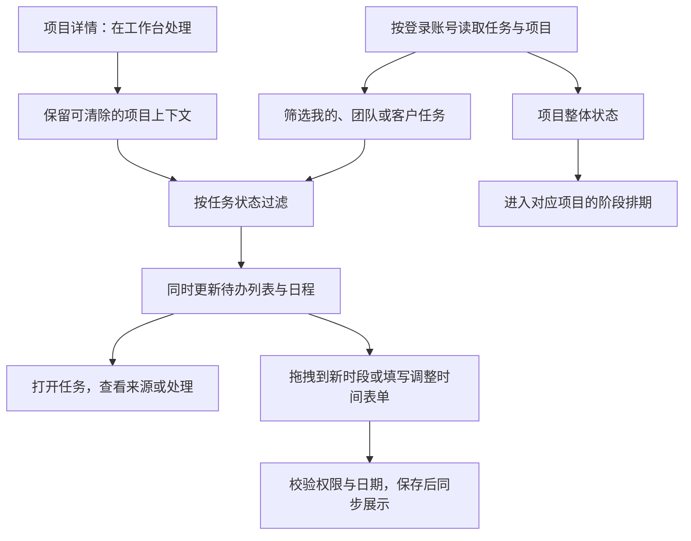

# PRD：工作台（企业 AI 经营大脑）

> 版本 v2.4 ｜ 当前专项开发基线 ｜ 2026-11-25
> 关联 [当前开发基线](PRD_企业AI经营大脑_当前开发基线.md)、[待办页面 PRD](pages/工作中枢-我的待办.md)、[项目管理 PRD](pages/工作中枢-项目.md)、[统一界面规范](../DESIGN.md)
> 原型 [工作台](http://127.0.0.1:8011/index.html?review=home) ｜ 源文件 `prototype/index.html`

## 1. 目标与范围

用户登录后先处理本人权限范围内的待办，随后查看本周安排和项目整体状态。工作台聚合项目、任务和会议的状态，排期操作写回对应任务。项目的阶段、里程碑与明细排期在「项目管理」维护。经营分析、企业资料和客户档案从各自的入口访问。

| 用户 | 所见与操作 |
|---|---|
| 员工 | 私人待办和有权处理的项目待办，可查看来源、提交结果、调整本人有权修改的排期 |
| 直属主管、部门负责人 | 有权访问的团队项目与任务，处理交接、汇报、督办与复核 |
| 分管领导 | 在权限范围内查看项目整体状态和待决策事项，从待办进入对应项目审批与决策 |

## 2. 布局与交互

1. 页头显示当前日期、「今日工作」与页面操作。「查看本周日程」定位本页日历，「管理项目」进入项目管理。
2. 首个业务区为「待办事项」。任务范围默认「我的」，可切换团队、客户；已选项目以可清除的标签显示。六个状态入口为全部、待处理、待执行、执行中、已完成、失败。范围和状态共用于任务列表和日历。
3. 待办保持平铺，逐条显示任务、负责人、项目、来源和下一步操作。决策与审批入口在待办区，仅有待处理事项时显示，点击定位到同一列表中的决策和审批。
4. 宽屏左待办、右日程，宽度不超过 1100px 时上下排列。日程默认显示当前自然周七天，可以切换周历或议程，也可切前后周或回本周。空周保留日期网格与切周操作，压缩空行并提示「所选周暂无排期」。
5. 项目整体状态放在待办与日程下方。按账号权限显示项目名称、当前阶段、整体状态和「查看排期」，并提供未结束项目、存在延期及会议处理中三项汇总。「查看排期」进入对应项目的阶段排期。
6. 视图和状态选中态共用系统主题浅色。导航和查看使用次按钮，状态改变使用对应操作按钮。手机端六个状态入口两行显示，主要触控目标为 44px。

## 3. 排期与数据

- 任务排期使用 `scheduledDate`、`scheduledTime`，同步更新展示值 `dueAt`。拖到周历时间槽使用目标日期与时间；拖到议程日期保留原时间，无原时间时使用 09:00。表单提供键盘与触屏等价操作。
- 项目可见性与任务可见性分别校验。项目汇总按未结束、存在延期及处理中会议计算；本人相关任务的存在不扩大项目权限。
- 当前原型使用本地演示数据及浏览器存储。生产建议用 `GET /home/summary`、`GET /tasks`、`PATCH /tasks/:id/schedule`，服务端鉴权、校验版本并记录前后排期。

## 4. 验收

| 场景 | 预期 |
|---|---|
| 主管登录并切换我的、团队、客户 | 待办和日历同步过滤，项目区仍按项目权限展示 |
| 领导选择决策与审批 | 同一待办列表定位到待处理项，可进入原项目处理 |
| 从项目详情打开任务 | 工作台保留项目标签并定位待办；清除后恢复当前任务范围 |
| 拖拽与表单改期 | 更新同一任务排期，列表与日程同步；权限或日期错误时保留原排期 |
| 本周无任务 | 保留完整周历与切周操作，显示空周提示 |
| 桌面、平板与手机 | 使用 [统一界面规范](../DESIGN.md) 所列尺寸；手机端状态按钮和项目查看入口无需横滑即可发现 |

2026-11-25 已在本地浏览器核对五个演示账号的项目可见范围，以及工作台、项目进入、筛选和移动布局。原型演示结果不能作为生产集成结论。
