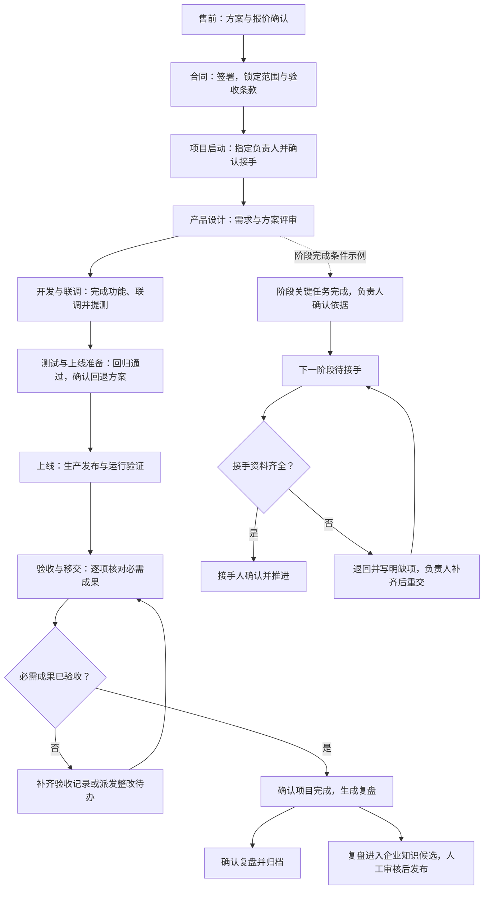
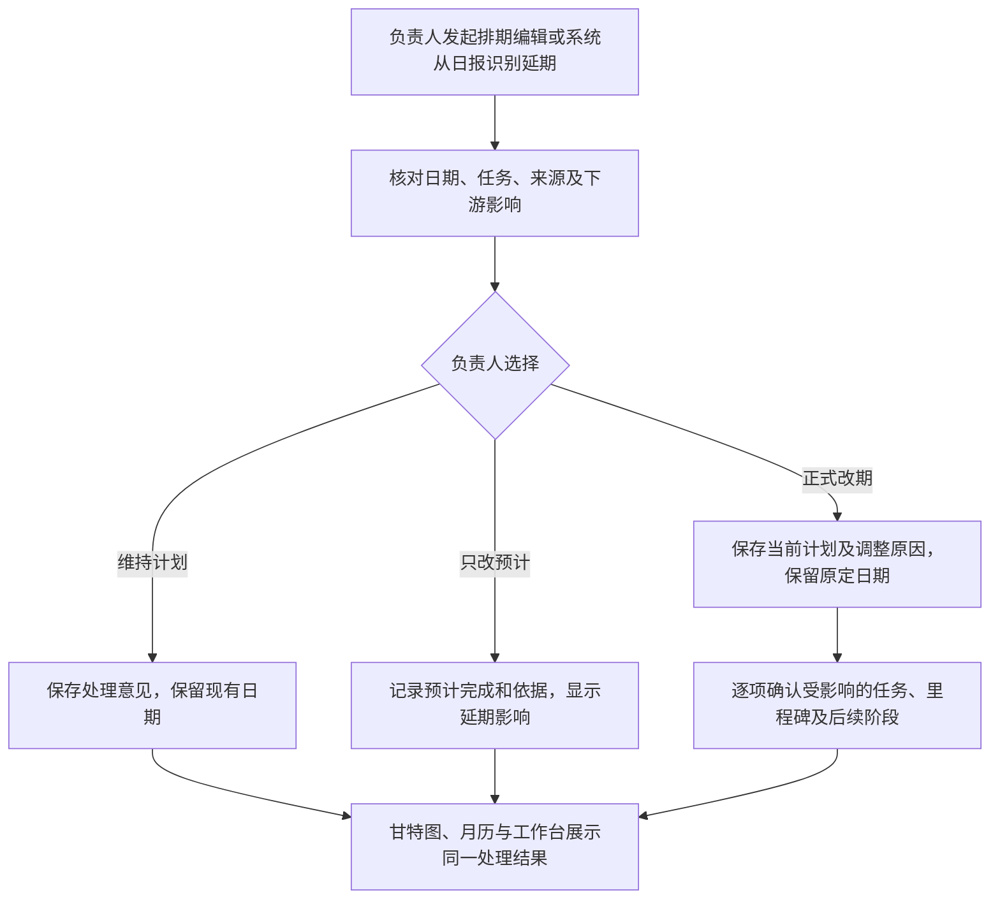
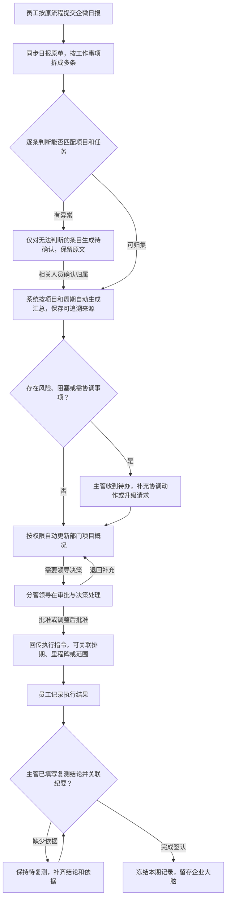
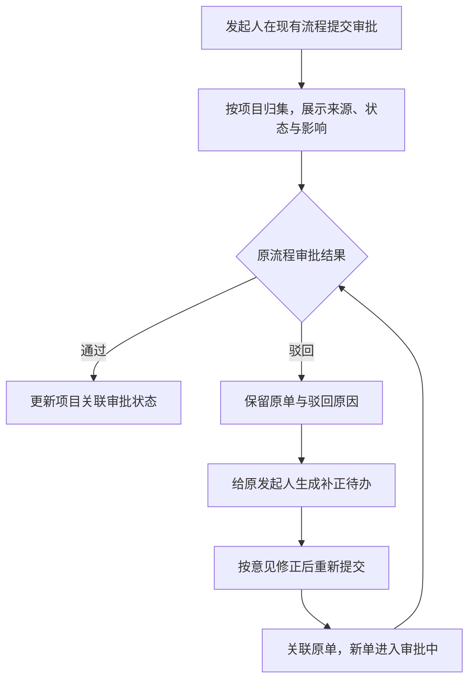

# 项目管理

> 页面 ID：`work-projects`｜版本：v1.23｜状态：原型已联通｜更新日期：2026-11-26
> 上位：[[../PRD_企业AI经营大脑_当前开发基线]]｜关联：[[企业大脑-会议纪要]]、[[工作中枢-我的待办]]、[[工作中枢-客户]]、[[设置-权限管理]]

## 问题

客户资料、会议、任务和成果分散在不同入口，同一项目的员工报价还可能与老板会议要求冲突，导致团队无法确认当前应依据哪个来源继续工作。

## 项目管理目标

帮助互联网公司的项目管理者掌握从售前、合同、项目启动、产品设计、开发与联调、测试与上线准备、上线到验收与移交的全过程。进入项目就能看清谁负责、计划何时完成、实际进展、哪里受阻、下一步由谁接手，以及凭什么确认交付。

1. **立项与任务派发**。创建项目时明确目标、范围、阶段负责人和排期。系统将各阶段的待办派到对应员工，支持并行准备；达到阶段完成条件后，更新下游既有任务的交接信息。
2. **进度监控与异常处理**。把计划、实际进度、里程碑、依赖和交接放到同一项目。通过项目列表、甘特图和日历识别逾期、阻塞及受影响的节点，明确处理人、下一步和依据。
3. **归集三渠道记录并更新项目**。从企微、飞书、钉钉的既有流程归集项目相关日报、审批、会议纪要与行动项，以及已授权的交付、发布或验收记录。按项目、阶段或任务识别归属，补充项目动态、进度、风险和阶段依据；保留渠道、原单编号、提交人、事件时间和原文。三渠道采用同一归集与回写规则，各平台读取范围由应用授权及接口能力决定。
4. **按岗位查看与逐级汇报**。员工看自己的待办和交接；项目负责人看全项目的任务、排期和风险；直属主管看团队进展和待协调事项；部门负责人汇总跨项目影响并上报；分管领导看待决策事项、影响、执行结果和复测依据。各层按权限查阅。
5. **阶段成果与交付验收**。按阶段归集方案 PPT、报价、沟通话术、上线及验收材料。需要时根据确认过的范围和来源生成草稿，并保留版本、确认状态和证据。必需成果通过验收、关键事项处理完成后，项目才可完成。
6. **结项与企业大脑沉淀**。确认复盘后归档项目。把有来源和权限的项目动态、决策、交付及验收记录沉淀到企业大脑；复盘先形成知识候选，经审核后再作为正式知识复用。

本地原型覆盖任务派发、模拟日报、阶段确认与交接及人工验收。真实数据采集、外部通知送达和服务端权限仍待联调。

## 目标用户

老板、项目负责人和项目成员。老板可查看角色数据范围内的项目全貌；员工只处理本人创建或参与的项目，并在口径冲突时收到明确提醒后自主判断，不要求老板审批。

## 页面入口

「项目管理」默认展示项目进度看板。每行显示当前阶段、下一里程碑、计划与预计完成日期、当前责任人、待接手、逾期和阻塞。按异常影响排序。PC 端点击状态统计筛选，点击「可见项目」清除状态筛选。项目列表、跨项目甘特图和月历共用搜索、筛选和项目访问权限。甘特图按项目、阶段、关键任务三级展示，阶段默认收起。展开后可查看任务负责人、计划区间、预计完成、前置任务和影响。项目负责人在项目详情维护任务，项目管理首页同步显示。月历展示所选月份的截止、预计和完成节点，点选节点可打开项目。项目负责人可拖动甘特条双端调整计划开始或截止，也可拖动条身平移排期并保持工期，或在「改排期」中准确填写日期，也可在日历分别拖动计划开始、计划截止和预计完成节点。实际完成日期随完成记录保存。

项目详情按售前、合同、项目启动、产品设计、开发与联调、测试与上线准备、上线、验收与移交展示关键里程碑。确认里程碑完成需提供完成依据，可引用归集自企微、飞书或钉钉的记录。新建并行项目的下游保留原待办及进度，收到上游交接记录；顺序交接演示中，由接手人在工作台确认。项目负责人可以记录催办、调整责任人和排期，处理记录保存在项目详情。

从一级菜单「项目管理」选择项目，可在同一份项目详情里切换六个页签。标题左侧返回图标回到进入详情前的项目列表或工作台。

| 页签 | 主要用途 |
| --- | --- |
| 项目概览 | 存在未关闭的风险、问题、冲突或排期异常时，在顶部显示风险提示；展示当前状态、原定与预计日期、阻塞原因与直接可见的受影响节点和延迟天数、当前里程碑、优先任务或交接、下一阶段，以及有记录时的待决策及最近进展。由具备权限的角色执行介入、接手或确认；通过对应入口查看排期、全部待办与汇报 |
| 任务与里程碑 | 当前待办优先展示，其他项目待办紧接其后直接展示。两组使用相同的任务、负责人、截止时间、状态、操作五列；随后展示项目里程碑及完成条件，可确认接手、直接查阅最近交接，直接查阅完成依据与更早的记录 |
| 阶段排期 | 切换甘特图和日历，查看或调整阶段及任务日期 |
| 动态与汇报 | 直接查看本期汇报摘要、最近关联会议和三方协作平台的原文，查看系统汇总并按需提交协调判断，直接查看企业大脑留存的流程记录和已归集渠道原文 |
| 审批与决策 | 优先显示部门待决策事项及批准、调整后批准、退回入口；下方显示部门依据、执行回执与跟进反馈，并可查看渠道审批进展，记录风险、问题、变更与决策，将决定和执行要求回传；分管领导可向项目指定角色写跟进反馈，并关联已归集的审批单。项目内反馈不改变原审批状态 |
| 阶段交付物 | 当前阶段优先，按阶段展示应交清单、待形成、待阶段启动、缺失或确认状态、版本和来源，可返回物料任务；生成和审阅在任务与里程碑，成果验收及项目资料仍可从此页查阅 |

负责人可手工新增里程碑，或从当前项目的会议行动项与相关渠道记录中选择建议。确认名称、日期和完成条件后加入工作台和阶段排期的里程碑日期清单，并保留建议来源。原型使用本地规则演示候选。

已有和新增里程碑统一关联确认待办。绑定前置任务时，前置完成后才派发确认待办。确认负责人记录已核实的依据后，里程碑和确认待办同步完成。

合同阶段完成前，负责人须录入已签合同编号或链接、已确认交付范围和验收约定，并指定项目启动的接手人。三项内容随进度记录留存，在阶段交付清单可查看。原型由人员核对签署事实。

原型用规则匹配原流程日报的「任务全名：已完成／阻塞／预计延期」。只有能查看日报的授权任务负责人或项目管理者可确认任务完成，阻塞及延期先提示并保留原文来源，阶段与排期仍需各自确认。

接手人可说明缺项并退回，项目负责人补齐后重新交接。审批驳回后，原发起人在工作台补正并重提，新旧原单互有关联。必需成果未验收时不能完成最终交付；验收未通过生成整改待办，提交后等待复验。领导决定可关联排期、里程碑或交付范围，并写入执行截止日期。

项目详情中的业务资料默认展开，包括延期推演、立项信息、阶段依据、历史汇报、项目资料和成员，可手动收起。

登录页提供员工、直属主管、部门负责人、分管领导及另一团队直属主管的独立示例账号。账号的汇报权限由项目指定的各级接收账号决定。工作台按登录账号显示需要处理的汇报或决策。从待办进入时保留对应项目，直接定位到可操作的页签。同岗位的其他团队账号无法查看该项目的汇报或通过入口打开待办。

### 项目管理评审入口

打开[项目管理原型](http://127.0.0.1:8011/index.html?review=projects)，选择「蔚然 · 分管领导」，查看以下模拟项目。

| 项目 | 核对的逻辑 |
| --- | --- |
| 极光科技 · 八阶段项目全流程演练（模拟） | 同一个项目查看八阶段与前置任务、两名员工日报、主管处理与部门上报演示、领导待决策、合同审批和阶段交付物。前四阶段有完成和来源记录，开发联调因接口资料待补而阻塞，测试、上线和验收为后续计划。 |
| 八阶段客户项目验收演练（模拟） | 查阅已验收、复盘归档和企业知识发布结果，和在途主案例分别保有各自的凭证。 |
| Lumen 经营诊断 | 联调预计延后三天，测试和上线排期受到影响。可以记录处理人、期限、决定和原因。调整当前计划后仍可对照原定日期。必需任务完成、阻塞解除后，由项目负责人确认提测依据，再由方婷从工作台接手测试阶段。 |
| 极光科技增长项目 | 合同已签，项目启动待陈宁接手。可用其账号从工作台确认接手。 |
| 云栈运营门户（模拟） | 生产发布和运行验证已完成，仍需客户验收和移交。可对照上线确认标记和当前验收节点。 |

阶段、任务和里程碑分别使用汇总条、任务条和菱形。后续影响按原型的顺序阶段及已有日期进行推演，原定计划、当前计划和预计结果分别展示。日期、账号、项目和处理记录用于本地演示。

## 用户流程

填写立项卡并关联客户 → 指定负责人和成员 → 建立里程碑 → 成员上传 PPT、文档、聊天记录或会议音视频 → 系统保留来源并生成项目理解候选 → 会议纪要确认关联后同步到项目 → 从项目进入当前项目待办 → 处理风险、问题、变更与决策 → 任务生成 PPT、报价、合同或沟通话术 → 客户确认与成果验收 → 完成项目 → 确认结项复盘 → 归档。

### 新建项目的任务流

创建人填写项目名称与项目负责人，并为售前、合同、项目启动、产品设计、开发与联调、测试与上线准备、上线、验收与移交指定负责人。项目创建后，同时向各阶段负责人派发工作台待办。各阶段默认并行开展，阶段前置条件用于校验完成。阶段起止日期可分别填写，未填沿用项目对应日期，两处都留空则待排期。开始晚于截止时拦截。创建确认页展示项目及八阶段负责人和日期。

员工在企微、飞书或钉钉的日报中提交进度和说明。原型通过工作台「去处理」进入阶段任务，打开对应渠道的模拟表单。0–99% 更新项目进度并保留现有负责人。提交 100% 时按阶段规则判断完成，满足条件后系统记录完成时间、关闭当前待办并通知下一阶段接入。下游沿用原待办和进度，系统补记上游完成通知及来源。所有阶段完成后，项目显示已完成。项目负责人可追溯每次日报及负责人。

渠道模拟表单提交后，项目保存渠道和原单编号。正式渠道日报采集、通知推送及完成信号校验待真实联调。以下交接、验收和逐级汇报规则继续用于既有详细演示案例。

项目列表汇总各阶段已完成、进行中、待处理、待确认和阻塞数量。阶段责任人变更可在具体阶段行转派，上线回退从上线行处理。上线待复验期间，其他并行阶段仍可汇报。

工作台待办直达对应阶段，显示排期及待确认原因。阶段行可查看上游日报原单号、提交人、交接内容与业务依据。模拟渠道按原单项目名称、阶段名称和提交账号匹配任务；匹配失败时提示核对原单且保留原项目进度。真实外部身份映射和持久化异常队列待联调。

新项目默认建立「客户验收与交付移交」必需验收项。末阶段完成时将依据关联到成果验收与阶段交付物。所有阶段完成后，必需成果未确认或仍有未关闭的风险、问题、变更时，项目保持待验收。由具备权限的管理方记录验收通过，且其他条件满足后，项目才进入已完成。

#### 并行准备与完成条件

| 阶段 | 可并行开展 | 确认完成条件 |
|---|---|---|
| 合同 | 准备草案、对齐条款 | 售前已完成，登记已签合同编号或链接。 |
| 测试与上线准备 | 准备环境、用例与验证计划 | 开发与联调已完成，登记测试报告编号或链接。 |
| 上线 | 准备发布计划及回退方案 | 测试与上线准备已完成，登记上线发布与验证记录编号或链接。 |
| 验收与移交 | 准备验收资料和交付清单 | 上线已完成，登记客户验收记录编号或链接。 |

渠道日报可照常记录进度。填 100% 时，前置未满足或缺业务记录的阶段保留进行中，并展示待确认原因。前置补齐后，负责人可在阶段行点「核对完成」，复用已归集日报并补齐业务记录，关闭任务并触发交接。并行阶段保留原进度及负责人。模拟渠道以填写的业务记录编号或链接演示完成依据，实际签署、测试、发布和验收记录校验需接入相应系统。

### 八阶段交付与交接

阶段进度和项目生命周期分别记录。后续节点先显示计划或待阶段启动；未产生的实际交付物保持待形成。每份已确认材料必须关联本项目的凭证，保留版本与审阅结果。

#### 各阶段的交接责任与依据

以下岗位用于说明业务责任。实际待办派给项目内配置的阶段负责人或接手人。任何阶段退回时，接手人填写缺项，原阶段负责人补齐后重提，项目保留退回原因与每次提交记录。

| 阶段 | 主责 → 接手 | 交接依据 |
|---|---|---|
| 售前 | 售前负责人 → 商务负责人 | 客户需求、已确认方案、报价范围和仍待确认的承诺。 |
| 合同 | 商务负责人 → 项目负责人 | 已签合同、服务范围、交付清单、验收条款与关键日期。 |
| 项目启动 | 项目负责人 → 产品负责人 | 项目目标、团队与分工、阶段计划、客户接口人及已知风险。 |
| 产品设计 | 产品负责人 → 开发负责人 | 已评审需求、设计稿或说明、验收标准、变更与遗留项。 |
| 开发与联调 | 开发负责人 → 测试负责人 | 提测版本、联调结果、可测试环境、影响范围与已知问题。 |
| 测试与上线准备 | 测试负责人 → 发布负责人 | 回归结果、未关闭问题及处置、发布计划与回退方案。 |
| 上线 | 发布负责人 → 项目或交付负责人 | 发布版本、时间、运行验证结果、异常处置和服务移交说明。 |
| 验收与移交 | 项目或交付负责人 → 客户验收方和内部接手人 | 验收确认、必需交付物、遗留问题责任人和运维移交记录。验收不通过时由项目负责人安排整改并重提。 |

本表用于评审各阶段业务交接。原型的具体派单能力以已配置的阶段负责人、接手按钮和验收路径为准。跨项目共用的岗位分配与替补机制需要结合试点组织确认。

#### 项目例外路径

异常可从项目概览进入对应业务页；需要具体人员处理时同步工作台待办。每条处理记录保留项目、受影响对象、来源、负责人、处理期限、结果及时间。同一来源重复到达时更新未关闭的同一事项。关联对象受权限限制时，异常列表也按同一权限裁剪。

| 编号 | 触发与入口 | 处理人与恢复条件 | 验收预期与当前覆盖 |
|---|---|---|---|
| EX-01 | 立项摘要缺项、客户尚未关联 | 创建人或项目负责人补齐；涉及合同交接时按对应阶段检查所需依据。 | 选填项显示待补充，合法的内部项目可暂不关联客户。原型可核对。 |
| EX-02 | 交接缺资料、接手人拒绝 | 接手人填写缺项，原阶段责任人补齐并重提；接手人再次确认。 | 退回期间保持待接手，原因与重提历史可查。原型已有入口。 |
| EX-03 | 负责人缺席、离岗或跨部门换人 | 项目负责人指定有权限的替补，由接手人确认当前阶段和未完成待办。 | 已完成记录保留原签认人；未完成项转派后旧负责人失去原处理入口。原型支持当前阶段及原负责人未完成的关键任务转派，接手待办出现在新负责人工作台。跨部门组织规则及其他关联待办批量迁移待联调。 |
| EX-04 | 排期缺失、日期非法、任务超出阶段或预计延期 | 项目负责人从阶段排期补设日期；涉及冲突时先看影响，再决定是否调整目标或后续阶段。 | 非法起止保留原计划，超出阶段或项目目标时显示影响。原型支持手动排期、影响推演以及日报延期建议确认后回写；超界审批待实现。 |
| EX-05 | 范围、报价或验收标准变化 | 项目负责人记录影响，按项目权限发起变更判断；涉及已签合同或外部审批时按原流程确认。 | 批准后采用已确认版本，原合同和物料保留。原型支持变更事项；跨渠道回执待联调。 |
| EX-06 | 日报归属不明、多人说法冲突、来源更正 | 作者确认模糊条目；项目负责人核对冲突来源，已匹配的正常事项继续自动汇总。 | 保留原文与更正历史，冻结快照可追溯。原型支持作者确认归属；冲突复核和更正回放待验收。 |
| EX-07 | 渠道员工映射失败、重复推送、来源失效或同步中断 | 对接管理员处理映射或重试；项目负责人仅处理影响业务推进的异常。 | 保留最后成功数据与错误时间；重试不计重；来源无权时隐藏。真实连接与故障恢复待联调。 |
| EX-08 | 外部审批驳回或撤回 | 驳回由原发起人补正并重提；撤回保留原状态和原因，后续以新生效结果更新。 | 驳回原单与重提单可追溯，撤回结果可见；正式状态回传待联调。 |
| EX-09 | 领导退回、执行超期或复测未通过 | 按退回意见由部门负责人补充；执行人在工作台回填结果，主管核对依据；未解除风险时继续跟进。 | 领导意见、执行记录和复测依据各自留痕。原型已有退回、回执和复测入口；超期提醒与失败重开待实现。 |
| EX-10 | 发布失败并回退 | 发布负责人在原发布系统回退，记录版本、影响和结果；项目负责人安排重新验证。 | 上线节点保持待验证，回退及复验留痕。原型支持录入回退结果、阻止继续推进及记录复验通过或失败；失败须填写说明和下次验证日期；实际发布系统回传待联调。 |
| EX-11 | 物料生成失败、依据过期或输入不完整 | 物料责任人按错误提示补齐依据或重试；已审阅成果更新时创建新版本。 | 保留旧版本与失败原因，失败不覆盖成果；真实生成、重试和版本联动待验收。 |
| EX-12 | 验收不通过或交付物缺失 | 验收方记录缺项，交付负责人指定整改人和期限，提交原验收方复验。 | 必需成果仍为未验收，禁止结项。原型已有拦截；外部验收回传待联调。 |
| EX-13 | 暂停、恢复或取消 | 项目负责人提交原因、影响、待办处置和复查日期，由项目治理角色确认；恢复前重新确认排期与负责范围。 | 原计划、历史记录和暂停时的状态可查；原型支持项目负责人记录暂停、停止阶段推进和排期变更，核对后恢复。暂停期间允许查看和跟进日报、审批及项目资料。取消和跨部门通知待实现，审批权限按试点组织配置。 |
| EX-14 | 结项或归档条件不满足、知识审核退回 | 项目负责人补齐验收、处理未关闭关键事项或确认复盘；知识审核人退回候选时填写原因。 | 不满足条件时保留当前状态。知识候选可重提，正式发布保留来源。原型已有结项及归档门槛。 |

#### 排期字段与写入规则

| 日期 | 来源与维护人 | 更新规则 |
|---|---|---|
| 项目开始与目标完成日 | 立项表单，由项目负责人维护 | 作为项目总体目标保存。填入目标完成日后，未设日期的阶段仍显示待排期。 |
| 阶段计划起止 | 阶段排期，由授权负责人确认 | 首次计划保留为原定计划；后续正式调整保存当前计划与调整原因。 |
| 任务计划起止与里程碑截止 | 任务排期、阶段默认区间或里程碑设定 | 独立保存已确认日期。修改阶段时检查关联任务、里程碑及后续阶段的影响，明确确认后再变更相应记录。 |
| 预计完成 | 负责人更新，或从日报提取建议后确认 | 预计值独立展示。确认延期预测时保留原计划；正式改期走独立确认。 |
| 实际完成 | 完成操作及有效完成依据 | 按完成记录写入。撤销或更正需要保留原记录与原因。 |

排期验收案例为联调原定周四完成，员工日报预计周五完成。分三次确认验证维持原日期、仅更新预计至周五、正式改期至周五。正式调整后仍可查周四的原定日期；测试和上线日期在对应负责人确认前保留。原型支持手工调整和影响推演；模拟日报按任务名称、延期关键词和 YYYY-MM-DD 日期识别建议，支持负责人确认后三种处理及跨视图回写。自然语言日期提取与真实企微采集待联调。

### 日报、逐级汇报与反馈

| 角色 | 默认可见内容与动作 |
|---|---|
| 员工 | 本人在原渠道提交的日报、退回意见、收到的执行指令及执行回执 |
| 直属主管 | 可见范围内的项目自动汇总与日报来源，处理阻塞、异常、协调和复测 |
| 部门负责人 | 查阅部门项目自动汇总，补充跨团队协调与决策请求，处理领导退回 |
| 分管领导 | 部门上报、待决策事项、已执行决定和复测结果。日报原文仍按其来源权限控制 |

企微、飞书、钉钉按各平台应用权限和接口能力读取员工级日报或日志。系统按渠道原单去重，把一份日报拆成独立的工作事项，结合员工参与的项目、任务名称及上下文逐条归类。同一份日报中的事项可流向不同项目。项目明确、任务指向不清的事项先归入项目动态，等待确认任务；项目归属不清的事项由日报作者或有权限的项目人员确认。已明确归属的事项照常进入汇总。系统保留原单编号和各条目的原文片段，人工改归属后同步更正相关项目汇总。

归类完成后，系统按项目和汇报周期自动汇总。每条汇总结论保留可追溯的来源编号。正常进展自动进入项目动态、部门概况和企业大脑。无法匹配项目、来源冲突或缺少关键依据的记录进入异常队列，已匹配的记录继续汇总。主管按需补充协调动作或升级请求。员工沿用渠道日报提交入口。

当前原型可用模拟渠道日报演示文本分条、项目与任务名称匹配、作者确认归属和自动汇总，旧的决策案例仍可演练。真实企微接口、语义匹配和风险升级自动派发按本节待验收。飞书、钉钉按各自渠道能力接入同一归集流程。

项目级汇报链以项目指定人员为准，渠道通讯录可提供默认关系。已正式上报后到达的日报补入相应记录，并保留已有上级判断；签认后的周期快照冻结。日报只能提供进度依据或候选建议，里程碑与计划变更仍走人工确认。原型主案例中的两名员工日报为预置演示记录，现场提交使用可登录示例账号。

### 渠道审批驳回与补正

项目内的跟进反馈与汇报决策分别留痕。外部审批结果按原流程归集。打款、开票或签署的实际执行归原业务系统，原型只演示项目侧的审批状态与动作。

## 新建与查看项目的数据来源

| 入口 | 业务数据与来源 | 权限、空状态和写入结果 |
|---|---|---|
| 新建项目 | 创建人填写名称、初始状态、目标、范围、成果、成功标准和计划日期；客户来自客户档案，负责人和成员来自本租户成员目录。 | 有创建权限的账号可保存，名称和负责人必填。选填摘要留空时，详情显示待补充。仅选一名员工时，从主通讯录建议已选成员中的汇报人，缺项在详情补齐。 |
| 项目概览 | 立项与结项内容来自项目记录；当前阶段、阻塞和最近进展来自任务、交接、风险与项目动态。 | 项目成员按权限查看。无未关闭风险时隐藏顶部提示，缺少日期或依据时保留待确认状态。 |
| 任务与里程碑 | 阶段模板及项目任务、人工设置的里程碑、前置任务、确认待办和阶段物料任务。 | 负责人或授权人推进任务、记录完成依据；前置任务完成后派发对应确认待办。没有确认依据时保留原状态。 |
| 阶段排期 | 项目计划日期、阶段区间、里程碑和任务起止日期。 | 有排期权限的用户调整共用日期，列表、甘特图和日历读取同一份排期。没有日期的项目或任务保留待排期状态。 |
| 动态与汇报 | 渠道日报、关联会议、系统按项目生成的日报汇总，以及各角色提交的判断与执行记录。 | 按项目成员和来源权限查看。日报按条目归集，待确认条目由作者处理。尚无汇报时显示空态，有项目历史时展示最近三条；已交付项目仍可查看历史汇报。 |
| 审批与决策 | 合同、报价、开票与打款状态来自原渠道审批单；领导决策来自项目内上报。 | 原单驳回后保留原因并给发起人补正入口。项目决策的批准、调整或退回写入项目汇报链。外部业务执行留在原系统。 |
| 阶段交付物 | 阶段任务产出、项目资料、已确认商务范围、物料模块版本、人工提交与验收记录。 | 按材料权限和角色查看。尚未交付的物料显示待形成。验收记录写回对应交付物；已交付项目优先展示验收与移交，隐藏确认范围和生成商务草稿入口。确认后的结项复盘进入企业知识候选。 |

## 功能规则

项目状态随业务动作自动更新。合同交接进入待启动；项目启动接手后进入执行中；验收阶段待接手显示待客户确认，接手后进入待验收；最后一个交付节点确认、必需成果已验收且关键事项清零后进入已完成；确认结项复盘后自动归档。项目概览展示当前状态。

1. 项目空间统一展示概览、资料、会议、待办、成果和成员。
2. 材料由上传账号拥有；`project`、`selected_members`、`private` 只控制内容可见范围，不替代系统角色权限。
3. 上传会议时可直接选项目；未选时仅展示 AI 推荐，人工确认后才写入 `projectId`，并幂等生成唯一会议材料链接。
4. “在工作台处理”保留 `selectedProjectId`，跳到 `home` 并只显示当前项目任务。
5. PPT 跳转营销物料 / PPT；报价与合同打开对应任务或版本来源；沟通话术进入客户档案 / 跟进助手。
6. 同项目口径冲突不覆盖旧文件，向员工展示差异；员工可采纳会议要求、保留本人版本并填写原因，或发起协商。
7. 项目生命周期为“待立项 → 待启动 → 执行中 → 待客户确认 → 待验收 → 已完成 → 已归档”，完成必须满足必需成果已验收且关键事项清零，归档必须已有确认的结项复盘。
8. 立项卡记录项目目标、预期成果、范围边界、成功标准、开始日期和目标完成日期；项目概览展示阶段、健康度、里程碑、风险/问题/变更/决策、成果验收和结项复盘。
9. 新增里程碑时必须填写计划日期和完成条件，并同步生成带 `projectId` 的负责人待办；里程碑仍在项目空间管理，任务排期在工作台处理。
10. 项目负责人或拥有“管理项目成员”权限的角色可以推进阶段、管理里程碑和事项、记录验收及确认复盘；AI 只提供判断和草稿，不自动改变项目状态。
11. 成果验收只记录成果名称、是否必需与客户确认结果；必需成果为空、未验收，或仍有未处理的风险/问题/变更时，项目不能完成。
12. 项目只有“已完成”后才能确认结项复盘；复盘确认后成为企业知识候选，仍需人工审核才能进入正式知识。
13. 项目事项按“是否需要某个人采取行动”进入待办：问题直接生成处理待办，变更生成影响评估待办，决策生成待判断待办；风险默认只记录，明确负责人和应对动作/截止时间或人工升级后才生成待办。
14. 项目事项与待办通过 `sourceProjectItemId` 一对一关联并幂等创建；同一事项不得重复生成主待办，项目页与工作台都能打开同一来源。
15. 负责人处理事项不要求老板逐项确认，但必须回填结果；决策还必须记录原因。完成待办同步关闭项目事项，项目页直接记录完成也同步完成关联待办。

## 异常与边界

- 无系统模块权限、数据范围或项目访问权时阻止打开，且不泄露资料标题与内容。
- 处理失败保留原来源、`errorReason` 和重试入口；重试沿用同一材料记录。
- `sourceAvailable=false` 显示“来源不可用”，只保留操作记录，不允许跳转或重试。
- 重复确认会议关联不得重复创建材料；重复执行任务不得静默覆盖原成果。
- 当前仅为可点击原型，不上传真实服务器，不接真实 ASR/大模型，不自动发送、签署或付款；系统不维护开票、不维护回款、不维护应收、不维护到账，项目状态不依赖财务数据。

## 字段交互/取值

- `Project`：`id`、`tenantId`、`customerId`、`createdByAccountId`、`ownerAccountId`、`memberIds`、`status`、`lifecycleStage`、`health`、`goal`、`outcomes`、`scope`、`successCriteria`、`startDate`、`targetDate`、`updatedAt`。
- `Milestone`：`name`、`ownerAccountId`、`dueDate`、`completionCriteria`、`status`。
- `ProjectItem`：`id`、`projectId`、`type(risk|issue|change|decision)`、`title`、`impact`、`responseAction`、`ownerAccountId`、`dueAt`、`escalated`、`status(open|resolved)`、`resolution`、`resolutionReason`。
- `Acceptance`：`title`、`required`、`status(待客户确认|已验收)`。
- `Retrospective`：`summary`、`confirmed`、`knowledgeCandidateStatus`。
- `ProjectMaterial`：`projectId`、`sourceType`、`sourceId`、`ownerAccountId`、`visibility`、`selectedMemberIds`、`status`、`sourceAvailable`、`errorReason`。
- `Task`：`projectId`、`ownerAccountId`、`sourceMeetingId`、`sourceConflictId`、`sourceProjectItemId`、`kind(risk|issue|change|decision)`、`evidenceTimestamp`、`deliverableType`、`resultId`、`resolution`、`resolutionReason`。
- 材料状态：`processing → ready | failed`；`failed → processing → ready`。来源归档与处理状态分离。

## 状态与权限

先校验 `tenantId` 和系统角色的模块 grant，再按 `all | team_self | self` 判断项目数据范围和项目成员关系，最后按材料 ACL 判断具体内容。材料所有者或拥有“设置材料权限”动作的账号可以修改范围；跨模块打开会议或 PPT 时再次校验目标模块查看权限。

## 数据与接口

对象为 `Project`、`ProjectMember`、`ProjectMaterial`、`Meeting`、`Task`、`Deliverable`、`Conflict`、`Milestone`、`ProjectItem`、`Acceptance`、`Retrospective`。建议接口：`POST /projects`、`PATCH /projects/:id/stage`、`POST /projects/:id/milestones`、`POST /projects/:id/items`、`POST /project-items/:id/task`、`POST /project-items/:id/resolve`、`POST /projects/:id/acceptances`、`POST /projects/:id/retrospective`、`POST /projects/:id/materials`、`POST /project-materials/:id/retry`、`PATCH /project-materials/:id/acl`、`POST /meetings/:id/project-link`。会议材料幂等键为 `tenantId + projectId + sourceType + sourceId`；事项主待办幂等键为 `tenantId + projectId + sourceProjectItemId`。

### 三渠道数据归集与状态回写

| 来源 | 回写规则 |
| --- | --- |
| 企微、飞书、钉钉日报或日志 | 分条识别项目、阶段与任务；归属明确的事实进入项目动态和汇总，结构化进度回写阶段；完成、阻塞、延期等正文表述按规则核对后更新。 |
| 合同、报价、开票、打款等项目审批 | 审批同步原平台的通过、驳回、撤回及补正重提结果。通过的审批可作为对应节点或交付物的依据，只有满足该节点其他条件才推进；驳回保留原因和原单，提示责任人补正，撤回后重新核对依赖该审批的依据。审批仍在原渠道处理。 |
| 会议纪要、行动项及其他业务记录 | 会议纪要提取已记录的结论、行动项、责任人及日期，补充项目动态，明确的项目行动项进入待办或待认领。发布、测试、交付及验收记录按权限作为节点依据，关键状态仍受对应业务条件约束。 |

同一外部记录以租户、渠道和原单标识去重。只处理已授权且明确归属的记录，无法匹配或相互冲突时进入待确认，已确认部分仍可归集。各项目仅展示授权范围内的片段与来源。

### 日报同步、归类与回写

一份日报涉及多个项目时按事项拆分。明确归属的事实自动进入项目动态和汇总；明确的结构化进度回写对应阶段。正文中的完成、阻塞、延期形成带原文的状态建议，由有权限的责任人确认后更新任务或排期。阶段完成仍须满足前置条件及业务依据，项目完成仍须通过必需成果验收。

例如，员工在同一份企微日报中写「项目 A：已完成联调；项目 B：验收材料预计周五提交」。两条分别进入对应项目动态。项目 A 的完成表述按任务完成依据核对，项目 B 的预计日期作为排期建议，确认前保留原计划。

| 记录 | 最小字段 | 写入规则 |
|---|---|---|
| 日报原单 | 租户、渠道、外部单号、外部员工 ID、原文、日报日期、来源更新时间 | 以租户、渠道、外部单号去重。重试沿用原单记录，保留更新时间。员工映射失败进入同步异常。 |
| 日报条目 | 原单 ID、条目 ID、原文片段、项目 ID、任务 ID、归类状态、修改人和时间 | 逐条归类。项目明确、任务未明确时先计入项目动态；项目不明时进入作者待确认。作者确认或调整归属后，更新受影响项目的未冻结汇总。 |
| 周期汇总 | 租户、项目、汇报周期、条目引用、版本、更新时间 | 按项目和周期更新；正常条目同步进入部门概况和企业大脑。已签认周期保留快照，迟到条目在项目动态附记。 |
| 风险或状态建议 | 项目、任务、建议类型、依据条目、处理人、处理结果 | 具备明确阻塞依据且需要协调时生成对应处理项。同一条目的重复同步沿用原处理项。任务、里程碑和排期由有权限的处理人按对应规则确认。 |

原单与条目分别鉴权。跨项目日报只向该项目可见人员展示该项目的片段；查看整份原单时再次校验权限。无查看权限时隐藏入口、标题和正文。同步失败时保留上一次成功的汇总并记录失败，重试成功后增量更新。

| 验收场景 | 预期结果 | 当前状态 |
|---|---|---|
| 同一日报覆盖两个项目，另有一句归属不清 | 两个项目分别获得对应片段，作者只需确认不明确的条目；汇总可追溯到原单编号。 | 原型演示，名称匹配 |
| 重放同一企微原单、企业映射失败或同步失败 | 重放不计重；异常有记录且可重试；已有汇总保持可用。 | 待接口联调 |
| 无权限账号读取跨项目日报 | 只能读到已获授权的项目片段；打开原单需单独校验。 | 原型有角色范围，服务端鉴权待联调 |
| 日报出现阻塞或建议完成 | 有依据的阻塞进入责任人待办，完成建议由有权限者确认。正常日报汇总直接供部门查看。 | 自动派发和确认闭环待验收 |

## Skill / Prompt

项目总结输入仅包含当前账号有权查看的资料摘要与证据引用；输出 `project_summary`、`risks`、`next_actions` 和 `source_refs`。缺少证据时标记 `insufficient_evidence`。报价冲突输出差异表和建议，不替员工做最终判断。

## 埋点事件

`project_created`、`project_stage_changed`、`project_milestone_created`、`project_milestone_completed`、`project_item_created`、`project_item_resolved`、`project_acceptance_recorded`、`project_retrospective_confirmed`、`project_member_updated`、`project_material_uploaded`、`project_material_failed`、`project_material_retried`、`project_source_opened`、`project_task_filter_opened`、`project_deliverable_opened`、`meeting_project_link_confirmed`、`conflict_resolved`。记录账号、租户、项目、来源、前后状态和时间。

## 验收标准

1. 老板与员工切换后，项目列表和材料内容符合系统权限、数据范围、成员关系与材料 ACL。
2. 项目资料可展示处理中、已完成、处理失败和来源不可用；失败项可重试并清除失败原因。
3. 项目会议可打开完整纪要并返回项目；重复确认不重复创建材料。
4. 项目待办入口只显示当前 `selectedProjectId` 的任务，并展示会议或冲突来源。
5. PPT、报价、合同和话术进入正确业务模块；无权限或来源不可用时不给出错误跳转。
6. 冲突处理保留原版本、决策原因和操作记录。
7. 创建项目可以填写完整立项卡；旧项目字段缺失时显示“待补充”，不阻止打开。
8. 负责人可以新增并完成里程碑、记录并解决项目事项、创建并确认成果验收；新里程碑对应待办可在工作台按项目查看。
9. 阶段不能跳过“待客户确认”和“待验收”；必需成果未验收或关键事项未清零时不能完成，未确认复盘时不能归档。
10. 项目页面不存在开票、回款、应收或到账维护入口。
11. 创建问题、变更、决策后，在工作台按所属项目可看到对应待办；纯记录风险不制造待办，升级后只生成一条。
12. 从项目页或工作台完成事项时，双方状态同步；未填写处理结果不能完成，决策未填写原因不能完成。

13. 五个示例账号检查项目可见范围、逐级汇报和原文权限；同岗位的其他团队主管不能读取该项目。
14. 新增接口验收：两名员工在企微提交后，系统按项目和周期生成一份汇总，重复同步不计重；一份包含两个项目的日报可拆分并分别归集，模糊条目进入待确认，其余条目照常汇总；正常进展无需主管操作即可供部门查阅；匹配失败或出现阻塞时才进入对应人员待办。旧版原型已用主案例验证两名员工、同一项目、同一汇报期内的提交与引用；领导可批准、调整后批准或退回，退回写明原因。
15. 甘特图起止端、整体移动和月历日期节点均可调整授权项；开始晚于截止时保留原计划。实际完成日由完成记录写入。
16. 审批驳回后，补正待办、原单和重提单可相互追溯；原状态与意见保留。
17. 390×844 下六个页签两行可达，列表行直接展示查看入口；宽表与排期可在其容器内横向阅读。

2026-11-25 本地浏览器复验了三渠道日报归集与原文、审批驳回补正、八阶段推进至复盘归档和知识发布，以及甘特图和月历日期变更。44 个页面及视图在 6 种规范尺寸下完成渲染检查。验收范围为可交互原型，生产回调、服务端写入和外部审批执行仍需联调。

## 核心指标

项目资料有效率、会议关联确认率、会议到任务转化率、项目待办完成率、成果回挂率、来源打开成功率、失败重试成功率和冲突平均处理时长，上线后建立基线。

### 列表展示

项目列表使用搜索、关注状态筛选和视图切换，按当前登录账号权限加载。重点展示项目名称、关联客户、当前阶段、下一里程碑、当前责任人、需关注事项和查看入口。项目创建时间独立记录，用于项目元数据。
